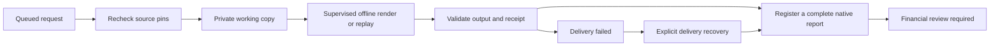

# Webapp Batch 2B — supervised background execution and report registration

Implemented 1 November 2026 for the local synthetic pilot. The worker consumes the
five saved-evidence profiles admitted by [2A](batch2a-job-admission.md), checks their
source identities again, rebuilds/replays them in private copies and registers a
new native report. The original financial runs and their files remain unchanged.

For example, requesting a saved close rerender produces a new report entry with
the same close period, EUR amounts, financial run ID, source versions and forecast
restrictions. It does not commit another accounting close. Research rebuilds
revalidate the saved model; monitoring renders the saved snapshot; event/news
profiles replay retained deterministic stages. These profiles acquire no new
market observations and make no paid model calls.

## Start the worker explicitly

```bash
.venv/bin/python -m keystone.workspace serve \
  --workspace output/workspace-native-4c \
  --port 8793 \
  --jobs-dir state/workspace-jobs \
  --enable-job-admission \
  --enable-worker
```

Use an existing registered native workspace. Enabling the worker processes the
queued jobs in the selected ledger. The workspace and its `runs` directory must
be private to the current OS user and writable. A fresh disposable workspace copy
is suitable for a rehearsal. The server still binds only to `127.0.0.1`.

The existing default server remains read-only. Admission alone continues to queue
requests while the worker is disabled. `--enable-worker` requires admission;
there is no browser-supplied worker flag or executable argument. Run forms and
token-entry UX are Batch 2C. The protected 2A POST/GET job endpoints work now.

Startup prints the token-file path and the requested worker mode. After startup,
`GET /api/execution` reports actual readiness as `worker_enabled` and
`worker_status` (`running`, `stopped` or `not_enabled`). The process must acquire
its worker lease and acknowledge readiness before application startup succeeds.
The token itself is never returned by an endpoint or passed to the worker.

## Execution and delivery



The worker owns one exclusive `worker.lock` lease per ledger. It claims the oldest
queued request transactionally; there is at most one execution attempt for that
job. Other workers cannot claim concurrently. Queue admission uses short SQLite
transactions and the shared maintenance lease, so new requests can be queued
while an enabled worker owns the financial mutator lease. Snapshot/restore still
requires exclusive maintenance. Financial execution and report registration
continue to serialize with other cooperative CLI mutations.

Before dispatch, the worker checks the complete source run fingerprint, native
registration and every registered artifact hash/size. It copies only those files
to `jobs/<job_id>/inputs`, validates the copy and records verification. It uses
server-generated paths and the reserved operation ID. Existing work directories,
operation identities or a result already registered under that job identity
cause a recovery hold rather than another execution.

The existing `keystone.operation.execute` supervisor runs the fixed
`workspace-saved` module in a separate process. Requests retain the selected
supervised-processing timeout, capped at 600 seconds, and the 12-request/48,000
reserved-output-token ceilings. Paid access and live data stay disabled. Queue
waiting, source preparation and registration are separate from that supervised
processing timeout.

The child receives a minimal offline environment, without provider credentials,
external dictionary configuration or a caller's live-data defaults. Its Python
socket entry points refuse network connections. A child alarm also bounds its
remaining lifetime if the supervisor is killed. This is a bounded local workflow,
not an OS isolation boundary against the trusted user or arbitrary repository code.
The worker lease is inherited by the supervised child, preventing a new worker
from taking over while that child is still alive. No stale-PID guess is used.

Original files are never rendered in place. Research may update validation, prose
and artifact bookkeeping only in its private model copy; its saved financial and
chart inputs must remain identical. The other four profiles preserve their primary
evidence bytes exactly. Event/news delivery also retains a new replay-verification
artifact. An unavailable/nonmatching replay is refused rather than promoted into
a successful new report.

## Atomic native registration

Successful processing produces a one-run, fully validated native staging workspace.
The supervisor receipt must identify the same job operation, request arguments,
limits, successful/review-required exit and zero reserved model usage. The worker
checks source parity, periods, units, entity, original financial run ID, review
state and staged file identities before recording a prepared result.

Registered results have IDs `result-<job UUID>`. Their `job_origin` links the job,
admitted source run/fingerprint, request fingerprint, profile and producer code
commit/dirty flag/module hash. These are traceability fields, not source
authentication or a reproducible-build attestation. The original financial run ID
and observation period stay separate from this new presentation identity/time.

The publisher copies complete, checked artifacts to a new run folder and flushes
them before atomically replacing the catalogue with an appended run entry. It
preserves the existing run entries and files. Readers see the old list or the
complete new list. Existing IDs, conflicting folders, changed staging files,
oversized inventories and an unexpected concurrent inventory change are refused.
The existing 100-run, 100MB workspace and 2MB inventory bounds remain in force.
There is no automatic deletion or retention cleanup.

The job then exposes `result_url: #/runs/<result ID>` through its protected status
endpoint. The existing report routes deliver the native view and verified downloads.
The page can load that route after refreshing its workspace inventory; automated
Run/progress/navigation controls are 2C. All current synthetic recipes end in
**review required**, with financial approval false.

## Durable status and audit history

The immutable admission envelope remains version 1, including its original source
pins, disabled-live/paid policy and reserved operation ID. SQLite control schema 2
adds a separate execution record and ordered audit events. Startup transactionally
migrates known v1 queued ledgers without changing IDs or idempotency history;
unknown/corrupt schemas are refused. The private admission snapshot still records
its original disabled worker flag; public job responses show current execution
status, managed-worker liveness and recovery requirements.
HTTP job objects use `schema_version: 2` and `admission_schema_version: 1` to make
this expanded public state contract explicit; request bodies remain version 1.

| Job status | Meaning / next action |
| --- | --- |
| `queued` | Waiting for the enabled worker; no processing attempt yet |
| `running` | Claimed once; source preparation, processing or registration is in progress |
| `review_required` | A complete native report is registered; inspect its financial restrictions |
| `completed` | Supported completed-state contract; current synthetic recipes still require review |
| `source_changed` | Admitted source no longer matches; no supervised processing started |
| `failed` | Preparation/processing/output validation failed; inspect private evidence before deciding on new work |
| `delivery_failed` | Verified output retained, registration incomplete or its acknowledgement failed; recover delivery |
| `outcome_unknown` | Interrupted/ambiguous attempt; preserve receipts and working files, then inspect |

Repeated request keys return the same job and its current status. They never reset
the attempt. Twenty queued/running jobs and 1,000 retained jobs are the limits;
completed jobs release pending capacity while retaining their duplicate history.
Execution changes and their events commit together. Reads validate record hashes,
phase and event consistency and remain free of mutations.

Normal shutdown signals the owned worker, terminates supervised processing if it
is active, records interruption and preserves queued work. On a later worker
startup, any leftover running record becomes `outcome_unknown` without rerunning.
An unexpectedly stopped managed worker is visible in capabilities; in-flight jobs
also expose `recovery_required`. The server does not automatically respawn workers.
An interrupted attempt may have produced private output or registered a report
before acknowledgement; failure does not prove that nothing committed.

## Delivery-only recovery

Stop the managed worker/server first, then use the same workspace and control
directory, with the actual job ID:

```bash
.venv/bin/python -m keystone.workspace recover-job \
  --workspace output/workspace-native-4c \
  --jobs-dir state/workspace-jobs \
  --job-id job-REPLACE_WITH_SAVED_ID
```

Recovery acquires the worker/mutator leases and verifies the saved input copy,
successful supervisor receipt, staged native workspace and prepared-result hashes.
It never invokes the renderer/replayer or a financial mutation. A folder already
promoted before a failed catalogue update must match exactly. A report already
registered before a lost acknowledgement is reconciled under its existing ID.
Repeated recovery produces no extra run or audit transition. Missing/changed
evidence or an unfinished operation is refused; it is not automatically retried.

## Local recovery coverage

Back up `jobs.sqlite3` as kind `file` / role `logs`, plus the `jobs` and `operations`
trees and separately declared registered report evidence. The existing explicit
snapshot tool joins the maintenance gate. Select these members explicitly;
the whole control directory contains the secret token and is deliberately refused.
Tokens are renewed on server restart; cache and lease files are not recovery proof.

A tested local restore can move the control trees to a new private directory for
the same canonical workspace path, retain job/operation identities and recover
verified delivery without executing again. Old absolute working paths in operation
receipts are checked as historical argument fingerprints; they are never opened.
An older queued snapshot whose result is already registered is held rather than
executed again. Rolling all history back can still erase post-snapshot facts;
reconcile newer work before enabling a worker. Workspace-path rebinding, independent
encrypted backup and clean-machine disaster recovery retain their existing status.

## Acceptance

`tests/test_workspace_worker.py` covers all five real offline profiles, source and
financial-value preservation, valid-looking altered output, migration, protected
HTTP execution, concurrent admission, single-worker ownership, deadlines, graceful
and hard exits, environment/network refusal, publication failures on either side
of catalogue replacement, delivery-only recovery, local restored delivery and
old-snapshot duplicate protection. The admission, operation, native-report and
storage regression suites remain applicable. Final validation is recorded below.

| Check | Local result on 1 November 2026 |
| --- | --- |
| Complete Python regression suite | **1,263 passed** |
| Worker acceptance cases | **27**, included in the suite; admission retains its **64** checks |
| Interface regression tests | **189 passed** |
| TypeScript and production build | Passed; no dependencies added |
| Actual enabled-worker HTTP rehearsal | All five profiles completed processing and registered native reports; review gates retained, zero reserved model requests |
| Duplicate submission and process restart | Same five job/operation IDs, one attempt each, no extra execution or report |
| Existing evidence preservation | All 32 original run entries and 138 original artifact files unchanged in the rehearsal copy; all 139 master-workspace files unchanged |
| Browser delivery | Inventory increased 32 → 37; all five new routes opened natively with no report iframe; complete copies retained 37/28/9/6/35 measures and 8/2/1/2/2 plots |
| Browser references/layout | No unresolved copy references or outer overflow in the inspected 1280px desktop states; no captured console warnings/errors |

The rehearsal used an isolated copy at `output/job-execution-2b/workspace`; local
receipts and the screenshot remain ignored under `output/job-execution-2b/`.
The enabled worker and admission server were stopped after the checks. A read-only
preview was left on port 8794 for inspecting the generated reports. Broader device,
human and full-workflow acceptance remain separately scoped.

Batch 2C is the Run/progress/token-entry interface. Batch 2D is the broader complete
workflow/recovery acceptance. Human report interpretation, physical accessibility,
actual PDF/print review, real-source permissions and production deployment remain
separate work.
