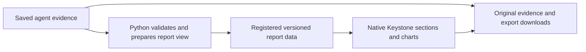

# Native report data contract

Contract version 1 · 30 October 2026 · Part 2A backend implemented for synthetic evidence.
Agent 1 frontend consumption is implemented in Parts 2B and [2C](part2c-charts.md);
other native workflow readers remain later work. See [data-layer scope](part2a-data-layer.md).

## 1. Ownership and lifecycle



The original agent record remains authoritative. The report view is a derived,
versioned presentation artifact. It does not replace sealed bundles, recalculate
results in JavaScript, call a provider/model, or bypass source gates. Current
catalogue metadata is not sufficient for native reports: it has small summaries
and formatted metric strings, not the typed values and series specified here.

A Python adapter validates the source schema,
resolves the required fields, preserves the engine's restrictions, prepares
supported text and chart series, and writes a **new** report-view artifact.
Publication of its inventory entry happens only after complete validation. No
write occurs when a browser opens a saved report.

Existing source directories are not migrated in place. An operator prepares a
new registered presentation revision/workspace when applying a new adapter.
Rebuilding a presentation must record its adapter/version and source identities
in the runtime registration; it does not imply new market observations.

## 2. Read interface

`GET /api/runs/{run_id}/report-view` supports HEAD. Runtime registration explicitly names
the view artifact, its hash, size and adapter version. A browser-supplied path,
source URL or database name cannot select the source.

The successful body follows [report-view.schema.json](report-view.schema.json).
JSON Schema uses internal references; its `.invalid` identifier is a design
identifier and is never fetched. Native scripts are trusted application assets;
raw source HTML is not injected into the page.

| Situation | Result | Intended reader experience |
| --- | --- | --- |
| Registered, validated view and unchanged source artifacts | 200/HEAD 200 | Native saved report |
| Known legacy run has no native-view registration | 409, `native_view_unavailable` | Explain the missing native view; offer only its valid registered original artifacts |
| Source/view schema unsupported | 409, `unsupported_report_schema` | Explicit unsupported-view state; no guessed field conversion |
| View/source hash mismatch, missing file or invalid registered view | 503, `saved_evidence_invalid` | Block the view and affected delivery; no stale “matched” claim |
| Valid catalogue; requested run/file not registered | 404 | Saved result not found |
| Origin/Host refused or mutation attempted | Existing 403/405 policy | No alternate access path |

The error envelope should contain only `error.code`, a safe `error.message` and
`error.retryable`; it must not contain file paths, credentials, source content or
a partial analytical report. Unknown new schema versions are refused. Original
downloads must still pass the existing inventory checks: the error fallback is
not permission to serve a changed or unregistered file.

Both the registered source and view are checked on delivery. A browser holds a
snapshot after load. If a later evidence request fails integrity checks, it must
show an unavailable/recheck state rather than silently substituting old content.
No response cache may mix a new source revision with an old report projection.

### Catalogue registration

The existing catalogue is strict schema version 1. Adding native-view metadata
there without changing its contract would fail validation. Part 2A therefore
introduces **catalogue version 2**, preserving the
existing original-HTML `report_id` and adding an optional `native_view` descriptor
to each run. The native artifact has kind `report_view`, a registered JSON filename,
actual SHA-256 and byte length, under the same confined file policy.

Example descriptor; the primary saved JSON and retained derived series are both registered sources:

```json
{
  "native_view": {
    "artifact_id": "native-view",
    "view_schema_version": 1,
    "adapter_id": "agent1-native-report",
    "adapter_version": "1.0.0",
    "source_artifact_ids": ["file-1", "native-series"]
  }
}
```

The view's `artifacts` entries must match exactly those registered source IDs,
names and hashes. The view does not include its own hash, avoiding a circular
hash dependency. Its own digest is held by the catalogue. Source bytes are not
rewritten to add presentation metadata.

The server accepts catalogue v1 as legacy with no native view, and v2
under the new contract. Older unsupported readers must refuse v2, not silently
ignore its new fields. Source-record schema versions remain agent-specific.

## 3. Envelope and identifiers

| Field | Meaning |
| --- | --- |
| `schema_version`, `kind` | Exactly `1` and `keystone.report-view` |
| `report_id` | Unique presentation revision within its runtime registration |
| `agent`, `workflow` | Explicit compatible agent/workflow pair; Agent 3 has two workflows |
| `identity` | Title, entity/listing, source run, financial period/scope and preparation instant |
| `state` | Recorded execution, mapped evidence gate, false financial approval, classification and matched source integrity |
| `artifacts` | Registered original names/IDs, actual SHA-256 and supported source-schema identifiers |
| `sources`, `evidence` | Source descriptions and exact artifact/JSON Pointer references |
| `summary`, `findings` | Backend-prepared, plain-language supported content with references |
| `metrics` | Typed numerical values and availability, independently of formatted labels |
| `sections`, `charts`, `tables` | Ordered native presentation elements linked by stable IDs |
| `review_items` | Grouped impacts with original source checks and affected sections |
| `analyst_content` | Explicit scope/availability of Keystone assessment, consensus and external research |
| `glossary` | Short contextual definitions; no numerical research claims |

Identifiers use lowercase letters, digits, underscores and hyphens. All IDs are
unique within their collection and all references resolve to the correct
collection. Section order is meaningful; neither the frontend nor an LLM silently
reorders evidence to suggest higher confidence. Successful payloads have matched
integrity. Unchecked/invalid integrity belongs to load/error state, not a successful
analytical view.

The financial approval field is always false in this local report version.
Evidence checks do not establish authenticated analyst sign-off. `evidence_gate`
is the conservative presentation outcome of the original engine gate plus the
workspace review policy; it must never claim that Agent 4 emitted an Agent 1
publication verdict. Source restrictions remain traceable in the review record.

## 4. Values, units, periods and dates

Canonical numerical values are **decimal strings**, or null. They have no currency
symbols, thousand separators, NaN, Infinity or exponent notation. This preserves
the stated decimal value and avoids treating a preformatted string as raw data.
It does not add precision that was absent from the original calculation result.

| Example | Canonical value | Unit | Currency | Human presentation |
| --- | --- | --- | --- | --- |
| Revenue | `32667300000` | `currency` | EUR | €32.67bn; exact amount available |
| Operating margin | `0.346` | `fraction` | null | 34.60% |
| Interest coverage | `2.1` | `multiple` | null | 2.1× |
| Event count | `8` | `count` | null | 8 |
| Published news tone withheld | null | `score` | null | Withheld + reason |
| Profit from 6500 integer cents | `65` | `currency` | EUR | €65.00 |

Python performs exact minor-to-major conversion and any financial/statistical
derivation. JavaScript may format labels and convert values to bounded chart
coordinates; it cannot change canonical values, calculate financial conclusions,
or introduce FX conversions. Values outside safe chart-coordinate precision are
shown through an exact table with an explicit graph limitation.

`period_label` describes the figure's own period. Statement period, price date,
estimate period and forecast horizon must not be conflated. Metric `as_of` and
source observation/publication/retrieval instants may be null; null does not
default to preparation time. Financial dates stay ISO calendar dates. Instants
retain timezone information; local display may use Europe/Berlin while exposing
the original instant. UTC news grouping remains UTC even when a tooltip displays
a local time. Relative event sessions require established alignment metadata.

## 5. Availability and display eligibility

| Availability | Value | Required interpretation |
| --- | --- | --- |
| `available` | Decimal string | Exists in saved evidence or an authorised Python derivation; may still be diagnostic/review-required |
| `unavailable` | null | Missing/invalid/unsupported for this saved result; display a reason |
| `withheld` | null | A published result is restricted by policy/gate; display the restriction |
| `not_applicable` | null | The measure does not apply to this section/workflow; explain that distinction |

`visibility` is `main`, `supporting` or `diagnostic`. It determines presentation
placement, not publication permission. A diagnostic metric remains diagnostic in
its tooltip, table and exports. The browser cannot move it into the main result
because it contains a finite number.

For held news, the published level stays null. If the engine separately retained
a diagnostic mean, it may be supplied as a different, diagnostic-only metric.
For historical events, valid descriptive arithmetic may be displayed with the
original restrictions; unavailable inference/intervals and future predictions
are never filled from the same diagnostic sample.

Sections also have availability and reason codes. A missing consensus section is
visible as unavailable rather than omitted from navigation. If only part of a
section is missing—for example, a forecast interval but an existing provisional
landing—the section remains available and the individual metric carries the
missing state. A section-level unavailable example can demonstrate a deliberately
narrow subsection; it must not conceal other eligible saved information.

## 6. Sources, evidence and narrative

Each evidence ID resolves to a registered artifact ID, its source description,
and an RFC 6901 JSON Pointer. The artifact entry contains its actual content hash.
Permitted transforms are identity, collection count, exact minor-to-major unit
conversion, or a named approved Python derivation. A derived series must record
the method, source paths, parameter values and its original coverage/exclusions
in the registered projection provenance; `approved_python_derivation` alone is
not sufficient provenance.

Source observation, publication and retrieval dates have distinct fields. An
unknown date needs a reason. Only canonical HTTP(S) source links are eligible for
clickable display; reject credential-bearing or executable URLs. Link handling
does not fetch article contents or claim that external content was verified.

Plain-language text blocks have a template identifier plus metric, evidence and
review references. The proposed template IDs in the examples are design names;
they are **not** a new whitelist already accepted by the current publisher.
Later implementation needs explicit templates and grounding checks before any
of these new summaries are delivered. Free-form model prose, raw HTML and an
unverified “opinion” do not enter through this contract as supported findings.

`source_check_refs` use `artifact:<artifact-id>#<JSON-Pointer>` for original saved
fields/checks, or `policy:synthetic-local-review/v1` for the explicitly named local
review policy. Grouping retains every original engine check and its details;
multiple peer warnings do not collapse into a lost source reference. The example
policy is not a real-company release approval.

## 7. Charts and tables

Charts specify type, purpose, availability, visibility, axes, series and points.
The series carries canonical values, not image coordinates. Non-null points link
to evidence. Null points have reasons and break a line; they do not become zeros
or a continuous interpolated path. Non-available charts have no data series.
Each available chart has an exact table/focus/touch representation from the same
supplied points; a second independently calculated dataset is not permitted.
An available chart needs at least one eligible finite point. If all points are
missing, the graph shows an unavailable state and its reason, not an empty plot.

For a waterfall, Python supplies start, end, value and favourable/adverse/anchor
classification. Anchors and steps must reconcile to exact saved amounts. For a
scenario comparison, the values and any weights are conditional assumptions.
For event paths, require verified session/date mapping and gap policy; array
position alone does not establish an announcement-relative calendar path.

Text tables name their columns. Numerical cells reference typed metrics; raw
number-like strings must not bypass units and availability. Every row supplies
the declared columns exactly once. A chart's accessible table is generated from
its series, so it does not need a duplicate entry in the `tables` collection.

## 8. Existing source mappings

Pointers below are source locations, not instructions to fetch or execute a run.

| Workflow / content | Existing source | Projection rule |
| --- | --- | --- |
| Agent 1 identity | `model.json /meta` | Preserve ticker, currency, statement period and source mode |
| Statements/ratios | `/analysis/get_financials`, `/analysis/compute_ratios` | Typed eligible fields with original periods/units |
| Trends | `/analysis/get_historical_trend` | Actual year/value pairs; no forecast substitution |
| DCF | `/analysis/run_dcf` | Keep applicability, value basis, per-share scenarios, parameters and default/review markers |
| Peer evidence | `/analysis/peer_outlier_check` | Keep exclusions, comparison status, periods and screening caveats |
| Analyst consensus | `/analysis/get_consensus` | Preserve `available`, target/estimate type, coverage, currencies and known date gaps |
| Price charts | `/chart_data/price_history`, `/chart_data/index_history` | Reuse Python definitions for date alignment, rebasing, moving averages, volatility and drawdown |
| Agent 1 narrative/gates | `/validation`, `/note`, `/note_template` | Retain restrictions; original draft text is not automatically publishable |
| Agent 2 snapshot | `snapshot.json /run`, `/current`, `/reviews`, `/decisions` | Original cycle/effective state and pending review remain distinct |
| Monitoring history | `snapshot.json /run/triage_history` | Use the actual saved original-cycle observations; absent history is unavailable, never inferred from a row or cycle count |
| Agent 3 events | `bundle.json /record/result/study`, `/gate`, `/scenario`; `/inputs/assembled_inputs` | Per-event observations, sample coverage, timing and exact gate restrictions |
| Agent 3 news | `/record/result/scored_items`, `/signals`, `/funnel`, `/exclusions` | Headlines/text scope and coverage; published null tone remains null |
| Agent 4 close | `close-*.json /report/full_hierarchy`, `/lineage`, `/sources` | Exact cents conversion and saved account profit-impact/favourability |
| Agent 4 forecast | `/report/reforecasts` | Separate forecast basis, provisional values, unavailable interval and calibration limits |

The current Agent 2 snapshot has no top-level schema version. Its adapter
must recognise a bounded explicit shape and record that source-schema assumption;
it must not treat arbitrary unversioned JSON as a monitoring snapshot. The five
examples cover selected content rather than every future report section.

## 9. Validation and size limits

JSON Schema validates shape, enums, basic date/decimal formats and conditional
availability. It cannot prove source accuracy, publication eligibility, text
grounding or cross-collection agreement. Runtime validation must also:

1. Verify the registered source/view hashes and supported schemas.
2. Reject duplicate IDs, broken references and incompatible workflow/source data.
3. Resolve evidence pointers and reconcile numbers, units, periods and transforms.
4. Apply original gates and the local synthetic review policy without upgrades.
5. Check template support and the distinction between fact, definition and question.
6. Validate chart dates/order/alignment, source coverage and exact bridge totals.
7. Keep withheld/missing values null in charts, tables, summaries and exports.

Implemented first-rollout bounds: 8 MiB per view within the existing workspace file
budget, 20 charts, 20,000 points across all charts, 5,000 evidence entries and
20,000 table cells. Per-collection structural maxima are also in the schema.
Enforce construction and delivery bounds; refuse an oversized view
explicitly. No silent truncation, series thinning, page freezing or dropped review
items. Any later pagination/decimation needs its own declared policy and checks.

## 10. Example verification and compatibility

Examples are derived from local synthetic saved artifacts prepared on
30 October 2026. Their hashes identify those snapshots, which are preserved under
the ignored local output directory. They are selected design examples, not
drop-in responses from an existing endpoint. Structural validation works without
those files; checking original values/hashes needs that exact local snapshot.

Part 1 checks schema validity, all five examples, unique identifiers, reference
resolution, original pointers/hash matches, available numbers/counts/exact unit
conversion, and the explicit missing/held cases. It also tries invalid values and
broken references to distinguish structural from semantic validation. No runtime
conformance, accessibility, financial approval or production acceptance follows
from those design checks. Later implementation is measured against the
[acceptance matrix](acceptance-matrix.md).

To repeat structural validation from the repository root using the existing
development environment:

```bash
.venv/bin/python - <<'PY'
import json
from pathlib import Path
from jsonschema import Draft202012Validator, FormatChecker
root = Path('docs/webapp/native-reports')
schema = json.loads((root / 'report-view.schema.json').read_text())
Draft202012Validator.check_schema(schema)
validator = Draft202012Validator(schema, format_checker=FormatChecker())
for path in sorted((root / 'examples').glob('*.json')):
    validator.validate(json.loads(path.read_text()))
    print(path.name, 'structurally valid')
PY
```

This short command does not perform source/gate reconciliation or cross-reference
checks. Those are separate semantic obligations, not capabilities of JSON Schema.
